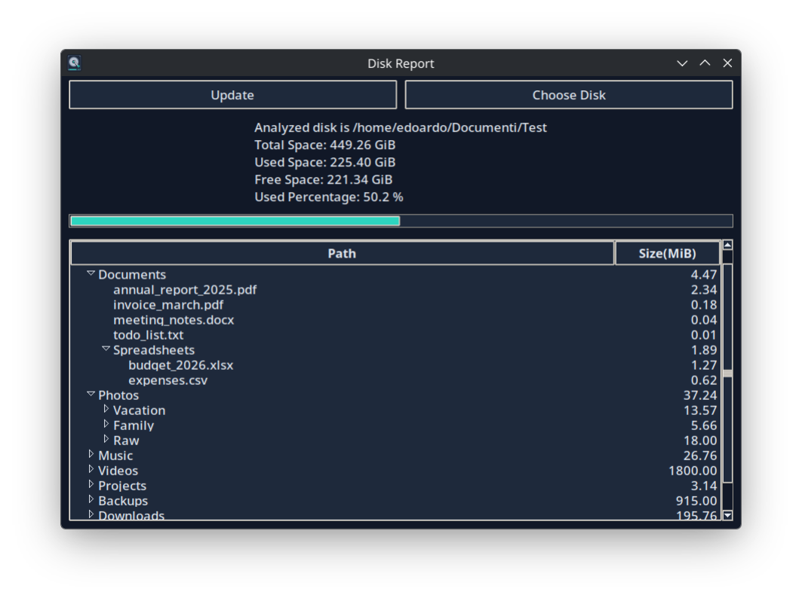

# Disk Report

A small program written in Python that scans a given directory and shows its files and the filesystem status



## Features
- Choose any directory through a folder picker
- Browse its contents in an expandable tree, with the size of every file and folder in MiB
- Folder sizes include everything inside their subfolders
- See the total, used and free space of the filesystem, with a usage bar
- Dark theme with teal accents

## Requirements
- Python 3 (tested on 3.14) with Tkinter (Tk 8.6)

## Usage
```bash
python disk_report.py
```

## Roadmap
- Scan directories in the background so the window stays responsive
- Sort the tree by name or size
